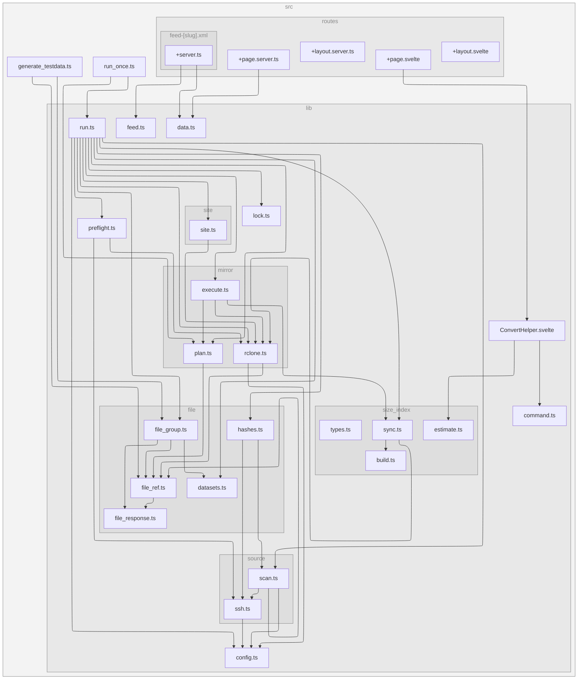

# download.versatiles.org

[](https://codecov.io/gh/versatiles-org/download.versatiles.org)
[](https://github.com/versatiles-org/download.versatiles.org/actions/workflows/ci.yml)

## Project Outline

This repository powers **<https://download.versatiles.org>** — the public distribution
endpoint for VersaTiles datasets.

It is a **batch updater** (not a web server). On each run it:

- scans the Hetzner Storage Box for `.versatiles` files and their `.md5` / `.sha256`
  sidecars over SSH, in a single listing
- reads the sidecars (or computes them on the Storage Box and stores them there if they
  are missing or older than their data file)
- compares every file with what is on **Cloudflare R2** and plans what to upload
- uploads the changed data files with `rclone`, each followed by its checksum files
- builds a **size index** for the latest release of each dataset (used by the site to
  estimate the size of a partial download)
- copies the latest release to its stable, undated key — inside R2, not from Hetzner
- builds the website (`index.html`, per-dataset RSS feeds, url lists) and uploads it

The data and the website are then served **directly from R2** over our own domain — no
reverse proxy in the request path, no per-GB egress fees, and no redirects. A small
[Cloudflare Worker](worker/) provides the `/` → `index.html` routing that R2 custom
domains lack.

The updater runs **once a month as a GitHub workflow**, and on a server for the uploads
that are too large for that — see [Running the updater](#running-the-updater).
The [runbook](docs/runbook.md) covers day-to-day operation: a failed run, a new release, a
new dataset, replacing credentials.

## Architecture

```
Hetzner Storage Box  (source of truth — where .versatiles files are produced)
        │
        │   Node.js updater  (monthly GitHub workflow; a server for very large files)
        │   1. check configuration and connections                       src/lib/config.ts, preflight.ts
        │   2. scan for *.versatiles and their sidecars, one listing     src/lib/source
        │   3. read or compute the hashes                                src/lib/file/hashes.ts
        │   4. plan: compare with R2 → upload / unchanged / deferred     src/lib/mirror/plan.ts
        │   5. per dataset: upload + checksums, size index,              src/lib/mirror/execute.ts
        │      then copy to the stable key within R2                     src/lib/size_index
        │   6. build the static site (SvelteKit prerender)               src/lib/site, src/routes
        │   7. upload site → R2          (LAST = atomic publish)
        ▼
Cloudflare R2 bucket  ── custom domain + Worker, $0 egress ──▶  https://download.versatiles.org/…
        │                                                          (data + sidecars + website)
        └──▶ consumed by the versatiles tile-server (resolves <slug> → URL via the convention below)
```

**Atomic publish.** The site is built from the files the plan says will be on R2, and
uploaded only after they are — so it never advertises a file that isn't fully present.
Within a dataset the stable URL is switched last: a new release is uploaded under its
dated key, its checksums and size index are produced from there, and only then is the
stable key replaced, together with its checksums and index.

**Verification.** A file counts as up to date only if the object on R2 has the same size
and carries the same MD5. After each upload or copy the object is read back and checked.

## Bucket layout & naming convention

There is no central catalog file — consumers rely on a predictable key convention plus
the sidecars:

- `https://download.versatiles.org/<slug>.versatiles` — stable "latest" key (overwritten in place)
- `…/<slug>.<date>.versatiles` — dated archival copies; they are never deleted
- `…/<file>.md5` and `…/<file>.sha256` — checksum sidecars of every data file
- `…/<file>.index.json` — size index of the latest release (under its dated and its
  stable key)
- website assets (`index.html`, `_app/…`, `feed-<slug>.xml`, `urllist_<slug>.tsv`) under
  their own keys

Which datasets exist — their titles, descriptions and order on the page — is defined in
[`src/lib/file/datasets.ts`](src/lib/file/datasets.ts). A `.versatiles` file on the
Storage Box that belongs to none of them stops the update.

> ⚠️ Change detection uses the **MD5 from the sidecar**, stored as metadata on the R2
> object — never the R2/S3 ETag, which for multipart (multi-GB) uploads is not the MD5.

## Development (frontend preview)

The website is a [SvelteKit](https://svelte.dev/) app prerendered with
`adapter-static`. To work on it you don't need any cloud access — `npm run dev`
generates sample data and starts the Vite dev server:

```bash
git clone https://github.com/versatiles-org/download.versatiles.org.git
cd download.versatiles.org
npm install
npm run dev
```

Then edit [`src/routes/+page.svelte`](src/routes/+page.svelte) (and
[`src/lib/ConvertHelper.svelte`](src/lib/ConvertHelper.svelte)) and reload
`http://localhost:5173`. Sample data comes from
[`src/generate_testdata.ts`](src/generate_testdata.ts); dataset titles and
descriptions live in [`src/lib/file/datasets.ts`](src/lib/file/datasets.ts).

> [!NOTE]
> This repo sets `ignore-scripts=true` in [`.npmrc`](.npmrc) (supply-chain
> hardening — dependency install scripts don't run). That also skips the root
> `prepare` step (`svelte-kit sync`), which generates the types and the
> `$app/tsconfig` base that `tsconfig.json` extends, into `node_modules/$app`.
> `npm install` removes that folder again each time it runs.
>
> You rarely need to care: `npm run dev`, `npm run build:site`, `npm run lint`,
> `npm run typecheck` and `npm run check` all sync first. Only your editor does
> not — if it reports `File '$app/tsconfig' not found` after an install, run:
>
> ```bash
> npm run prepare    # svelte-kit sync (skipped during install)
> ```
>
> The install warnings (low-severity audit advisories, funding notices) are
> harmless.

## Configuration

The updater is configured via environment variables. On a server they come from a `.env`
file (copy [`.env.sample`](.env.sample)); in the workflow from the `updater` environment
on GitHub.

| Variable                   | Required | Description                                                                         |
| -------------------------- | -------- | ----------------------------------------------------------------------------------- |
| `DOMAIN`                   | yes      | Public domain used to build absolute URLs (e.g. `download.versatiles.org`).         |
| `STORAGE_URL`              | yes      | SSH target of the Storage Box (`user@host`).                                        |
| `STORAGE_ROOT`             | no       | Folder on the Storage Box that is scanned (default `/home`).                        |
| `SSH_KEY`                  | no       | SSH identity file (default `.ssh/storage`).                                         |
| `SSH_PORT`                 | no       | SSH port of the Storage Box (default `23`).                                         |
| `SSH_KNOWN_HOSTS`          | no       | Known-hosts file with the Storage Box host key. If set, the host key must match it. |
| `RCLONE_SFTP_REMOTE`       | yes      | Name of the rclone SFTP remote (source).                                            |
| `RCLONE_R2_REMOTE`         | yes      | Name of the rclone S3/R2 remote (destination).                                      |
| `R2_BUCKET`                | yes      | Target R2 bucket name.                                                              |
| `RCLONE_BIN`               | no       | Path to the rclone executable (default `rclone`).                                   |
| `RCLONE_SFTP_STRIP_PREFIX` | no       | Prefix removed from Storage Box paths to form rclone SFTP paths (default `/home/`). |
| `MAX_UPLOAD_GB`            | no       | Skip uploads larger than this many GB (1 GB = 2^30 bytes). Unset: no limit.         |
| `DRY_RUN`                  | no       | `1` to only report what a run would do.                                             |

Only `npm run setup` reads these three, to create the rclone R2 remote on a server:

| Variable               | Description                                                                                                                    |
| ---------------------- | ------------------------------------------------------------------------------------------------------------------------------ |
| `R2_ACCESS_KEY_ID`     | S3 access key of an R2 API token with _Object Read & Write_ on the bucket.                                                     |
| `R2_SECRET_ACCESS_KEY` | The matching secret access key (not the token value).                                                                          |
| `R2_ENDPOINT`          | Account-level S3 endpoint, without a bucket path. The bucket is in the EU: `https://<ACCOUNT_ID>.eu.r2.cloudflarestorage.com`. |

A run starts by validating all of this and by checking that the Storage Box and both
rclone remotes are reachable, and reports every problem at once.

## Running the updater

```bash
npm run once                # update
npm run once -- --dry-run   # only print what an update would do; changes nothing
```

A dry run lists the uploads, the copies within R2 and the size indices that are due. It
only reads, takes no lock, and can be used at any time.

| Exit status | Meaning                                                                                                  |
| ----------- | -------------------------------------------------------------------------------------------------------- |
| `0`         | Everything is up to date.                                                                                |
| `1`         | The run failed. Nothing is half-published: the site is uploaded last.                                    |
| `2`         | Everything was updated except uploads above `MAX_UPLOAD_GB`; those still have to be run without a limit. |

### Monthly, as a GitHub workflow

[`.github/workflows/update.yml`](.github/workflows/update.yml) runs the updater at
03:00 UTC on the 20th of each month, and on demand (_Actions → Update → Run workflow_,
optionally as a dry run).

A hosted runner cannot move a file of hundreds of GB within the six hours a job may take,
so the workflow sets `MAX_UPLOAD_GB=80`. That covers a new OpenStreetMap release.
**Larger uploads are skipped:** the run still updates everything else — and for a skipped
file the site keeps describing the version that is on R2 — and then **fails** with a
message naming the files that have to be handled on a real server. It fails again every
month until that has been done.

The workflow reads its settings from a GitHub environment named `updater`:

| Kind     | Name                   | Value                                                                         |
| -------- | ---------------------- | ----------------------------------------------------------------------------- |
| secret   | `STORAGE_SSH_KEY`      | private key that is authorized on the Storage Box                             |
| secret   | `STORAGE_URL`          | `user@host` of the Storage Box                                                |
| secret   | `R2_ACCESS_KEY_ID`     | S3 access key of the R2 API token                                             |
| secret   | `R2_SECRET_ACCESS_KEY` | the matching secret access key                                                |
| variable | `STORAGE_KNOWN_HOSTS`  | known-hosts line(s) of the Storage Box, in the form `[host]:23 ssh-ed25519 …` |
| variable | `DOMAIN`               | `download.versatiles.org`                                                     |
| variable | `STORAGE_ROOT`         | folder to scan                                                                |
| variable | `R2_BUCKET`            | bucket name                                                                   |
| variable | `R2_ENDPOINT`          | `https://<ACCOUNT_ID>.eu.r2.cloudflarestorage.com`                            |

While any of them is missing the workflow only prints a warning.

### On a server, for large uploads

A file above the limit — today satellite, elevation and hillshade-vectors — is uploaded
from a persistent host, which has no time limit:

```bash
cp .env.sample .env    # fill it in; leave MAX_UPLOAD_GB unset
npm ci
npm run setup          # installs rclone and creates the two remotes from .env
npm run once
```

The [runbook](docs/runbook.md#uploading-a-large-file-from-a-server) has the full procedure.
A lock file (`data/.lock`) keeps two runs on the same host apart. It does not reach across
machines: do not start a server run while the workflow is running, or the other way round.

For the very first sync of an empty bucket, `npm run once` uploads everything; it can be
interrupted and started again, and continues with the files that are not on R2 yet.

## Cloudflare Worker

The site root routing, range/resume and CORS handling live in [`worker/`](worker/). It is
deployed by CI whenever a push to `main` changes it; see
[`worker/README.md`](worker/README.md).

## Verification checklist

After a deploy / cutover, confirm:

- [ ] `https://download.versatiles.org/` returns the HTML index (Worker `/ → index.html`)
- [ ] `https://download.versatiles.org/<slug>.versatiles` streams the bytes directly (HTTP 200, **no redirect**)
- [ ] HTTP range/resume works: `curl -r 0-1023 …/<slug>.versatiles` returns `206 Partial Content`
- [ ] sidecars resolve: `…/<slug>.versatiles.md5` and `.sha256`
- [ ] browser `fetch()` works cross-origin (CORS headers present)
- [ ] `Content-Type` of `.versatiles` objects is `application/octet-stream`

## Available Scripts

- **`npm run setup`**: Installs & configures rclone on the host from `.env`.
- **`npm run once`**: Runs the updater once (`run_once.ts`); add `-- --dry-run` to only print the plan.
- **`npm run dev`**: Generates sample data and starts the SvelteKit dev server.
- **`npm run build:site`**: Prerenders the static site to `build/` (`vite build`).
- **`npm run check`**: Runs everything CI does: format check, lint, typecheck, unit tests, browser tests and the worker typecheck.
- **`npm run lint`** / **`npm run format`**: ESLint / Prettier.
- **`npm run typecheck`**: `svelte-check` + `tsc`.
- **`npm run test`** / **`npm run test-coverage`**: Vitest.
- **`npm run test:e2e`** / **`npm run test:e2e:ui`**: Playwright browser tests.
- **`npm run upgrade`**: Updates dependencies.

## Running Tests

The project uses **Vitest** for unit tests and **Playwright** for browser tests.

```bash
npm test                # unit tests
npm run test-coverage   # unit tests with coverage
npm run test:e2e        # browser tests, all engines
npm run test:e2e:ui     # browser tests, interactive
```

### Browser tests

`e2e/` drives the real UI in Chromium, Firefox and WebKit plus two mobile device
emulations. They cover what neither the unit tests nor
[`src/build_output.test.ts`](src/build_output.test.ts) can see: a dialog that
opens but is unusable, a control that only responds in one engine, a focus ring
that never appears.

Browsers are **not** installed by `npm ci` — `.npmrc` sets `ignore-scripts=true`
— so run this once:

```bash
npx playwright install chromium firefox webkit
```

`npm run test:e2e` builds the site and serves it on port 4173 by itself; there is
no dev server to start first. It tests the production build deliberately, since
the CSS the browser receives has been through lightningcss.

Useful flags:

```bash
npx playwright test --project=webkit          # one engine
npx playwright test dialog                    # one spec
npx playwright test --grep @map               # only the map tests
npx playwright test --headed --debug          # watch it happen
```

The suite is offline: the size index, the map tiles and the logo are all served
from [`e2e/fixtures.ts`](e2e/fixtures.ts), so no test touches production. Map
tests skip themselves where the browser has no WebGL2.

### Checking real Safari

Playwright's WebKit shares Safari's engine but not its UI layer, and it always
tracks recent WebKit — so a Safari-only or older-Safari problem can still slip
through. After changing the download dialog, build and open it in Safari:

```bash
npm run build:site && npm run preview:site
```

- [ ] the `…` button opens the dialog, and the command and Copy button are visible
- [ ] resizing the window keeps the result bar on screen
- [ ] dragging a zoom thumb past the dialog's edge does **not** close it
- [ ] choosing "bounding box" loads the map, **and a box outline is drawn on it**
- [ ] dragging that outline updates `--bbox` in the command
- [ ] the web console is clean — the map sets itself up from the map's `init` callback, so an
      exception there leaves a map that renders but does not respond, with the command still
      showing a `--bbox` the user cannot see or change
- [ ] Copy puts the command on the clipboard
- [ ] with macOS **Full Keyboard Access** on (System Settings → Accessibility → Keyboard),
      Tab reaches the format options and the focused one shows a visible ring — with it off,
      Safari tabs to nothing in the dialog, which is the platform default rather than a bug
- [ ] tabbing/arrowing through the format options shows a visible focus ring

## Code Structure Overview

- **`src/run_once.ts`** — entry point; maps the outcome to the exit status.
- **`src/lib/run.ts`** — orchestrates the whole pipeline.
- **`src/lib/config.ts`**, **`preflight.ts`**, **`lock.ts`** — configuration from the environment, connection checks, and the lock file.
- **`src/lib/source/`** — SSH helpers and the scan of the Storage Box (`ssh.ts`, `scan.ts`).
- **`src/lib/file/`** — the dataset table (`datasets.ts`), the domain types `FileRef`, `FileGroup`, `FileResponse`, and the hash/sidecar handling (`hashes.ts`).
- **`src/lib/mirror/`** — `plan.ts` decides what happens to each file, `execute.ts` carries it out dataset by dataset, `rclone.ts` wraps the single rclone operations.
- **`src/lib/size_index/`** — builds the size index of a container (`build.ts`), keeps the indices on R2 current (`sync.ts`), and estimates download sizes in the browser (`estimate.ts`).
- **`src/lib/site/`** — writes `data/fileGroups.json`, runs `vite build`, uploads the site, the checksum files and the url lists.
- **`src/routes/`**, **`src/lib/data.ts`**, **`src/lib/feed.ts`**, **`src/lib/command.ts`**, **`src/lib/ConvertHelper.svelte`**, **`src/app.html`** — the SvelteKit frontend.
- **`src/generate_testdata.ts`** — sample data for local dev.
- **`worker/`** — the Cloudflare Worker that fronts the R2 bucket.

## Contributing

Contributions are welcome! Please submit a pull request or open an issue for any
improvements or bugs you find.

## Dependency Graph

<!--- This chapter is generated automatically --->



## License

This project is licensed under the MIT License.
